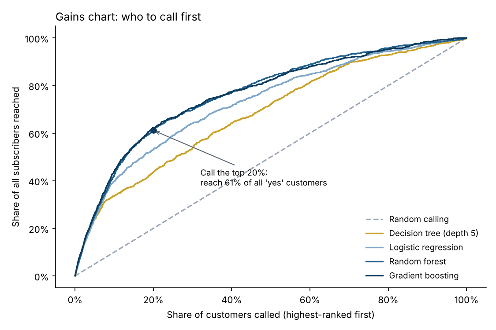
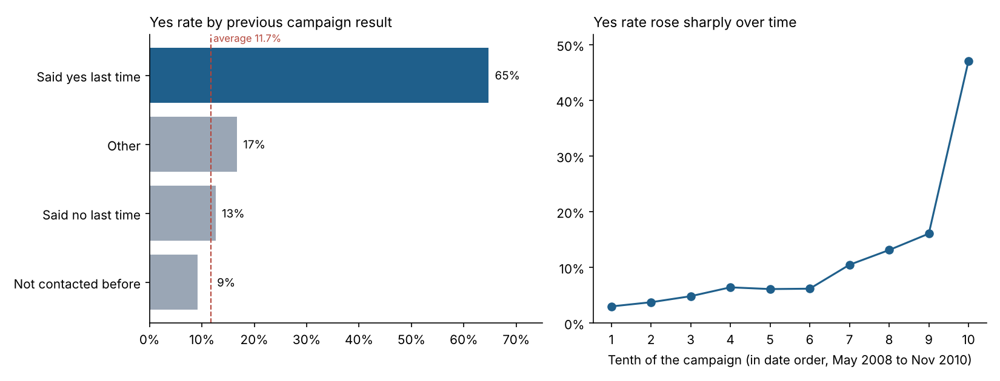

# Bank Marketing: Who Should the Bank Call?


A Portuguese bank phoned **45,211 customers** to sell a term deposit, and **11.7%** said yes. Calling everyone is expensive, so the useful question is: **which customers should be called first?**

My [first version](notebooks/01_original_notebook.ipynb) trained a decision tree and reported 88% accuracy with 47% recall on customers who said yes. Revisiting it, I found that the recall figure was wrong.

## The bug: precision and recall were swapped

The original called `classification_report(pred, y_test)`. scikit-learn expects the true answers first and the predictions second, so this swaps precision and recall in the report. Re-running the same tuned tree:

| Tuned decision tree | As reported | Actually |
|---|---|---|
| Recall: share of "yes" customers it finds | 47% | **9%** |
| Precision: share of its "yes" picks that are right | 9% | **47%** |
| Accuracy | 88.2% | 88.2% |
| Accuracy of always guessing "no" | | 88.3% |

So the model found fewer than 1 in 10 of the customers who would say yes, and was slightly *less* accurate than guessing "no" for everyone. Accuracy can't show this, because nearly 9 in 10 customers say no anyway.

## A better question: rank customers, then call from the top

Instead of a yes/no prediction, the models below give every customer a score and rank them. The bank then calls from the top of the list. I measured how many of the eventual "yes" customers each model puts near the top.



| Model | ROC AUC | Yes rate in the top 10% | Share of all "yes" customers in the top 10% | ...in the top 20% |
|---|---|---|---|---|
| Random calling | 0.50 | 11.7% | 10% | 20% |
| Decision tree (depth 5) | 0.70 | 39.4% | 34% | 44% |
| Logistic regression | 0.76 | 46.5% | 40% | 53% |
| Random forest | **0.80** | 49.4% | 42% | 61% |
| Gradient boosting | **0.80** | **51.3%** | **44%** | **62%** |

*Tested on the same 6,782 customers (15%) as the original notebook, with the same random seed.*

**In plain terms:** if the bank calls only the 20% of customers the gradient boosting model ranks highest, it reaches **62% of everyone who would say yes**, with 80% fewer calls. In the top 10%, about **1 in 2** say yes, against roughly **1 in 9** when calling at random.

## What drives a "yes"



- **Past behaviour matters most.** Customers who said yes to the previous campaign said yes again **65%** of the time, more than five times the average. The original notebook dropped this column (`poutcome`), but it's known before the call is made, so it's fair to use. It's now included.
- **Timing changed everything.** The data runs in date order from May 2008 to November 2010, and the yes rate climbed from about 3% to 47% over the campaign. This is worth asking the bank about: it may reflect interest rates after the 2008 financial crisis, or a change in who was being called.

## The honest caveat: the future is harder

A random test split mixes customers from every period. As a stricter check, I trained on the first 80% of the campaign and tested on the last 20%, which simulates using the model on future calls.

| Test | ROC AUC |
|---|---|
| Random split (above) | 0.80 |
| Train on earlier calls, test on later ones | **0.69** |

The yes rate in the later period (32%) was nearly five times the earlier one (7%), so much of what the model learned was out of date. A real deployment would need **retraining as new results come in**.

## Deliberate choices

- **Call duration is excluded.** It's the strongest predictor in the data, but it's only known once the call has ended, so it can't help decide who to call. The original notebook got this right, and a test makes sure it stays out.
- **Categories are one-hot encoded** instead of being turned into numbers like 0, 1, 2. Ordinal codes imply an order that doesn't exist (as if "student" were greater than "admin").
- **Models are judged on ranking**, using ROC AUC and the share of "yes" customers in the top 10% and 20%, rather than accuracy.

## Run it yourself

```bash
git clone https://github.com/ranzith1282000-beep/bank-marketing-prediction.git
cd bank-marketing-prediction
pip install -r requirements.txt
python src/bank.py   # about a minute; writes results/ and the charts in images/
pytest               # 5 tests
```

## Repository layout

```
├── src/bank.py                           original check, models, ranking metrics, charts
├── tests/test_bank.py
├── data/bank-full.csv                    45,211 calls
├── results/                              results.csv and two check files
├── images/
└── notebooks/01_original_notebook.ipynb  my first version
```

## Tools

Python, pandas, scikit-learn, Matplotlib, pytest, GitHub Actions

Data: the Bank Marketing dataset from the UCI Machine Learning Repository (Moro et al., 2014).
